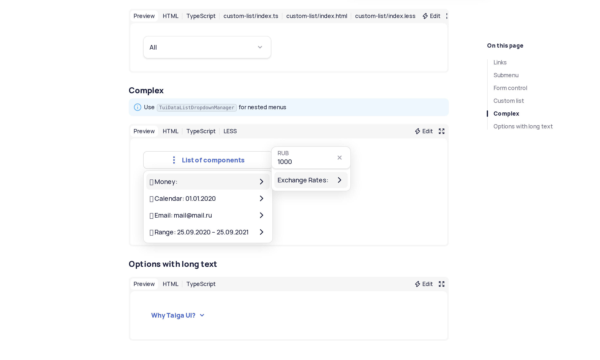
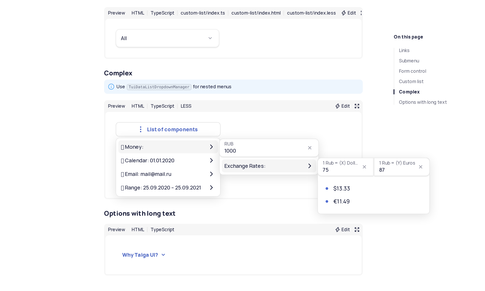

# Nested dropdown rendering reproduction

This reproduces the `Data list / Complex` documentation screenshot scenario on the native CSS anchor positioning path. A
nested panel can be absent from the captured image even though all three dropdown hosts are attached. Repeated captures
can disagree. The JS positioning control paints all three panels consistently in the tested runs.

This is a repository-based reproduction, not a standalone CSS reduction. The problem was confirmed in headless automated
screenshots; headed/manual reproduction and a Chromium root cause have not been established.

## Run

This branch starts from `9adad073277508b15d9f8ffb185f5051b561f68e`, before the runtime workaround in PR #15337. Use the
repository's Node >=26 and npm >=11 requirements.

```sh
npm ci
npm start
```

In another terminal, set `CHROME_PATH` to the Chrome for Testing headless-shell executable you want to test. The config
inherits the repository's Chromium project, font stubs and screenshot preparation. A compiled demo served at the same
URL can also be used; this is how the recorded runs were executed.

```sh
export PW_BASE_URL=http://localhost:3000
export CHROME_PATH=/absolute/path/to/chrome-headless-shell
export REPRO_BROWSER_LABEL=stable

npx playwright test -c repro/nested-dropdown/playwright.config.ts --update-snapshots
npx playwright test -c repro/nested-dropdown/playwright.config.ts --repeat-each=3
```

Inspect the baseline as well as received images: a baseline can itself contain a missing panel, and a passing comparison
alone does not establish correct rendering. More repetitions may be necessary because the result varies between runs.

Run the existing JS positioning fallback as a control, using separate baselines:

```sh
export REPRO_POSITIONING=js
npx playwright test -c repro/nested-dropdown/playwright.config.ts --update-snapshots
npx playwright test -c repro/nested-dropdown/playwright.config.ts --repeat-each=3
```

For Canary, change `CHROME_PATH` and use `REPRO_BROWSER_LABEL=canary`. Unset `REPRO_POSITIONING` to return to native
positioning.

The test opens `Data list / Complex`, prepares the screenshot after opening the menu, checks that three dropdown hosts
exist, captures the menu, edits the money value and captures again. It attaches the browser version, motion preference,
device scale factor and dropdown geometry to the report. Native and JS panel geometry differs; the relevant symptom is a
missing panel, not equality between the two positioning implementations.

## Recorded results (2026-11-04)

Linux x64, headless Chrome for Testing, Playwright 1.64.1, Taiga UI repository version 5.31.0, viewport 1500 x 900, DPR
2, reduced motion enabled. Three repetitions per row, after generating a separate baseline for that browser/mode.

| Browser              | Native positioning                                | JS control |
| -------------------- | ------------------------------------------------- | ---------- |
| Stable 157.0.8103.38 | 1 screenshot mismatch, 2 renderer crashes         | 3 passed   |
| Canary 159.0.8141.0  | 1 screenshot mismatch, 1 renderer crash, 1 passed | 3 passed   |

Renderer crashes are recorded separately and are not counted as proof of the missing-panel bug. The screenshots below
show the missing Exchange Rates panel on Stable and the JS control with all panels painted. Fonts/icons in this local
setup are imperfect, but the panel visibility difference is separate from those assets.

### Stable: native positioning



### Stable: JS positioning control



Browser versions were obtained from
[Chrome for Testing metadata](https://github.com/GoogleChromeLabs/chrome-for-testing/blob/main/data/last-known-good-versions-with-downloads.json),
timestamp `2026-11-03T22:51:17.271Z`.

## Related reports

- [Taiga UI PR #15337](https://github.com/taiga-family/taiga-ui/pull/15337): nested dropdown JS positioning workaround.
- [Chromium #581484644](https://issues.chromium.org/issues/581484644): related report supplied for cross-reference; a
  shared root cause has not been established.
- [Taiga UI #15296](https://github.com/taiga-family/taiga-ui/issues/15296): possibly related
  native-anchor/reduced-motion dropdown visibility issue. This reproduction uses the existing default demo; whether the
  mechanism is identical remains unverified.
